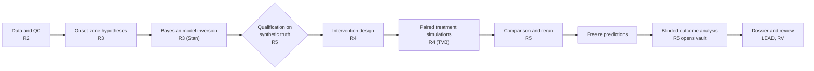

# VirtualBrain: a decentralized multi-agent research system for epilepsy treatment choice

VirtualBrain is a collective of specialised AI agents that does research on one hard clinical question: should a patient with drug-resistant focal epilepsy get surgery or neurostimulation? The agents survey the evidence, curate patient cases, build virtual-brain models, simulate treatments and check one another's work.

No agent can approve its own output. A deterministic controller admits each task against a frozen role profile, and it records every artifact, gate decision, need and repair in an append-only ledger. Outcome labels stay sealed in a vault until predictions are frozen. The design follows the ScienceClaw framework in `framework/`.

> Research evidence on literature and virtual patients only. Nothing in this repository is a clinical recommendation.

## 1. The problem

- **Consequential.** About a third of people with epilepsy keep having seizures despite medication. For them, the main options are resection or laser ablation of the seizure-onset (epileptogenic) zone, or neurostimulation (RNS, ANT-DBS, VNS). A wrong choice can mean an operation that fails, or years of stimulation that does not help.
- **Open-ended and hard.** The onset zone is not directly observable. It has to be inferred from intracranial EEG, MRI and connectivity through nonlinear brain models whose inversion is often ill-posed. The clinical literature compares treatments across different cohorts, endpoints and follow-up times.
- **Scientifically meaningful.** Virtual brain twins (Wang et al. 2025, *Nat. Comput. Sci.*) propose to simulate each treatment on a personalised model before acting. Whether such models can be fitted and trusted on a given patient is an open question. Answering it needs exactly the discipline this system enforces: benchmarks on known truth, blinding, independent checking and an audit trail.

## 2. Technical pathway: from virtual brain to treatment comparison

Study-002 follows the full pathway on Patient 2 of Wang et al. 2025. Each step is a separate task by a separate role. It ends in a committed artifact (`A00xx`) that another role must pass before the next step may use it.

### 2.1 Data and case curation (R2: `A0007`–`A0011`)
- **Inputs.** Each virtual patient has simulated bipolar SEEG, a structural connectome over the 162-region VEP atlas and an SEEG gain matrix. Patient 2 has 191 channels sampled at 125 Hz.
- **Checks.** R2 re-hashed every file against the retrieval manifest. It also checked montage, units and sampling rate.
- **Split.** Patient 1 is the development case and the source of the synthetic benchmarks. Patient 2 is the blinded test case, and its ground truth went into the vault.

### 2.2 Virtual brain model and inversion (R3: `A0017`–`A0019`, `A0036`, `A0037`, `A0040`)
- **Network model.** A 2D Epileptor sits at each atlas region, and the regions are coupled diffusively through the connectome. The key unknown is each region's excitability `x0`. A region counts as epileptogenic when `x0 > -2.06`, the bifurcation point of an isolated node.
- **Observation model.** SEEG features are high-passed at 10 Hz, log-power is taken over 1 s, and the result is downsampled to about 2 Hz. The model maps them to the network state through the gain matrix, with channel offsets and AR(1) residuals.
- **Hypotheses.** R3 stated four competing onset-zone hypotheses before fitting: left dorsolateral prefrontal, orbito/mesial prefrontal, left amygdala, or no supra-threshold region. It also prespecified two analysis windows: post-stimulation (primary) and full (sensitivity).
- **Inversion.** Bayesian inversion ran in Stan (CmdStan 2.40). It used a 24-start L-BFGS MAP ensemble and NUTS with 16 chains on a cloud VM. The log density was verified against an independent NumPy implementation.
- **Model versions.**
  - **v2** patches the package's `vep_mcmc.stan`. It fixes the channel-skipping likelihood loop and the double log, and adds AR(1) residuals.
  - **v3** cuts the model from about 520 to 68 parameters (40 free `x0`) with a principal-component likelihood.

### 2.3 Qualification on known truth (R5: `A0042`)
- **Benchmark.** Before its use on Patient 2 counts, each model version must recover a planted onset zone from synthetic SEEG built on Patient 1's connectome.
- **Pass rule.** The planted region must rank first, every `x0` R-hat must be below 1.05, and there must be no unexplained divergences.
- **Result.**
  - **v2** ranked the planted region 2nd, with R-hat up to 4.7.
  - **v3** never finished NUTS warm-up.
  - R5 recomputed R-hat from the stored draws and ruled every model bundle NOT QUALIFIED. The Patient 2 fits therefore continue only as labelled exploratory predictions.

### 2.4 Intervention design (R4: `A0020`–`A0035`)
R4 turned the onset-zone estimate into 18 candidate treatments, each with an explicit region or contact rule:
- **Virtual resection or ablation** of the top-1 region, the estimated onset zone, or the onset zone plus propagation zone. Each one is modelled either as ablation (`x0` set to the healthy value −3.0) or as disconnection (its connectome rows and columns set to 0).
- **SEEG stimulation** at the contact with the largest gain to the estimated onset zone. The options are a biphasic 50 Hz pulse train (acute or chronic, 4 amplitudes) and sustained current at one or two sites.
- **Excluded.** Temporal-interference stimulation was planned but excluded as infeasible: there was no mapping from the field maps to the atlas regions.

### 2.5 Treatment simulation (R4: `A0038`)
- **Forward model.** The paper's 6D Epileptor with a stimulation term (`SpatEpiStim`) in The Virtual Brain (TVB). It used a Heun integrator with dt = 0.05 ms, over horizons of 7.8 s (post window) and 14.4 s (full window).
- **Paired design.** Every candidate run has a no-treatment baseline that shares its `x0`, coupling, initial state and noise seed (`1000 + i`). This covers 648 candidate runs over 24 + 12 MAP optima, with no pairing mismatches.
- **Outcome definitions.** A region is *seizing* when its fast variable keeps crossing −1 (gaps under 250 ms) for at least 1 s. The SEEG metric counts channels whose log-power exceeds the paired baseline by 3 SD for at least 1 s.

### 2.6 Comparison (R4 and R5: `A0038`, `A0041`)
- **Effects.** Each effect is the candidate minus its paired baseline for the same optimum, reported as the median with a 5–95% range across optima.
- **Ranking.** Candidates are ranked by the median reduction in seizing regions, with ties broken by total seizure duration.
- **Exploratory result.**
  - **Full window.** Ablating the onset plus propagation zone did best: −3.0 seizing regions (median, 5–95%: −4.9 to −1.6), abolishing all seizures in 42% of optima. Pulse-train stimulation gave no reduction.
  - **Primary window.** No optimum seized at baseline, so the ranking there was uninformative.
- **Independent rerun.** R5 reran six arms and got bit-identical results. It also recomputed every effect from the stored runs.

### 2.7 Blinded outcome analysis (R5: `A0043`)
- **Order of access.** The predictions were frozen and hashed first (ledger seq 205). Only then did R5 alone get vault access (seq 214).
- **Onset-zone recovery.** R5 scored precision, recall and the true region's rank for every frozen estimate, with 2000-resample bootstrap intervals.
- **Treatment check.** R5 re-simulated R4's 18 frozen candidates on the true Patient 2 configuration, plus an oracle ablation of the true onset zone.
- **Result.** Recall was 0 in every window, with the true region ranked 46th–159th of 162. The true model has no spontaneous seizure, so a treatment ranking cannot be checked. The dossier reports both points.

### 2.8 Reports and visualisation
- **`reports/study-002-summary.html`.** An interactive 3D view of the Patient 2 cortex with 205 SEEG contacts and simulated region activity before and after treatment, plus the truth check.
- **`reports/study-002-R4-simulations.html`.** Per-region seizure heatmaps and effect distributions for every candidate. Its generator re-derives each effect and re-hashes the batch files.

## 3. What was achieved

### Study-001: real patients, literature and public data
- **Literature dossier.** R1 committed 32 evidence claims comparing resection, laser ablation (LITT) and neurostimulation (RNS, ANT-DBS, VNS). R5 checked each claim against its source text, and grouped papers on the same patients into one study family.
- **Case curation.** 10 patients with intracranial EEG (SEEG and ECoG) curated from OpenNeuro ds004100, with every file re-hashed by the independent evaluator.
- **Modeling.** The virtual-brain inversion pipeline failed its qualification benchmark, so no patient model was used. The study adapted: it skipped the treatment-simulation stages instead of simulating on an unqualified model.

### Study-002: a blinded virtual patient from Wang et al. 2025
- **Blinding.** The ground-truth onset zone was sealed in the vault. Predictions were frozen and hashed in the ledger (seq 205) before the evaluator was granted vault access (seq 214).
- **Defects found.** The collective found four known problems in the pipeline it was given: a likelihood loop that skips the first channels of a column-major vector, a sampling rate hard-coded to 250 Hz (Patient 2 is 125 Hz), observations logged twice, and non-convergence (R-hat up to 6.4, 24 MAP optima with different top regions). It also found that Patient 2's recorded seizure follows a 50 Hz stimulation train.
- **Self-rejection.** Two inversion models (v2, v3) were benchmarked on synthetic data with a planted onset zone. Both failed, and R5 ruled every model bundle NOT QUALIFIED.
- **Treatment simulations.** Paired simulations of resection/ablation and SEEG stimulation on the paper's TVB model were run and then reproduced bit for bit by R5. They are labelled exploratory.
- **Truth check.** Once the vault was opened, the frozen onset-zone estimate missed the true region, and the true model showed no spontaneous seizure. The system therefore reported "EZ recovery not achieved" and "best intervention not determinable", rather than a recommendation.
- **Review.** An independent clinical-engineering review accepted the dossier after two repair cycles.

**Why this matters.** Both studies end in negative results, and the system reached them on its own before any claim was made. Catching a broken pipeline and an unsupported treatment ranking is the outcome a trustworthy research collective should produce when the evidence is not there. The novel part is the method: preregistration-style blinding, frozen releases and independent gates, enforced in code for a team of AI agents.

## 4. Decentralized agency

Each role has its own information, tools and permissions, set in `system/profiles/*.json` and enforced by the controller when a task is admitted.

| Role | What only this role does | Distinct access |
|---|---|---|
| R1 Evidence scout | Literature search, source verification, dataset and method discovery | Web search; no case data |
| R2 Case curation | Data verification, signal and anatomy QC, case records, cohort splits | Case data; no web search |
| R3 Virtual patient | Network hypotheses, virtual-brain model fitting (TVB, Stan) | Case data; ran its MCMC fits on a cloud VM |
| R4 Intervention design | Surgery and stimulation scenarios, simulation batches | Case data; no web |
| R5 Independent evaluation | Source checks, model qualification, reruns, blinded outcome evaluation | The **only** role that can read the sealed vault, and only after predictions are frozen |
| RV Clinical-engineering review | Accepts or sends back the final dossier | Case data; no web |
| R6 Improvement research | Failure analysis and proposals for future releases | Cannot change an active study or approve its own proposal |

**How they coordinate without a script.**
- **Gates.** Every artifact is checked by a role other than its producer. 134 gate decisions were recorded across the two studies.
- **Needs.** A role that is missing something posts a scoped need to the ledger, and another role claims it. 22 needs were opened (for example, R1 asking for dataset acquisition, R5 asking for a repaired report).
- **Repairs.** A failed gate issues a repair to the producer. There were 11 repair cycles.
- **Refusals.** The controller refused 7 task proposals that broke a rule: inputs from the wrong case, stale or superseded inputs, or an outcome evaluation requested before predictions were frozen.
- **Adaptation.** The path through each study changed with the evidence. Study-001 dropped its treatment-simulation stages after R5 failed the model. Study-002 built a new model version (v3) after v2 failed its benchmark, and stopped short of a recommendation once v3 failed too.

**Honest limit.** A lead role (`run-study`) proposes tasks and dispatches agents. It cannot read case data or the vault, and it does not admit tasks: the controller admits or refuses each one against the role profiles. The collective is governed, not leaderless.

## 5. Execution and validation

- **A functioning system.** The controller is a working CLI. The dashboard shows agents, timeline, needs, gates and artifacts live. Both studies ran end to end: study-001 in 6 h (33 tasks, 104 artifacts, 538 ledger events) and study-002 in about 4 h 20 min (23 tasks, 53 artifacts, 306 ledger events).
- **Invariant tests.** 12 controller tests (`python -m unittest discover -s system/tests -v`), all passing. They cover role permissions and scope, no self-gating, unreviewed or stale inputs, repairs, needs, vault access only for R5 after the freeze, budgets and frozen releases.
- **Benchmarks on known truth.** Each inversion model was tested on synthetic data with a planted onset zone before use on the patient.
- **Blinded real-truth check.** Frozen predictions were scored against the sealed ground truth (`studies/study-002/artifacts/A0043-OutcomeEvaluation/`).
- **Reproducibility.** Per-artifact SHA256SUMS, fixed seeds and frozen skill and profile releases. R5 reproduced the treatment simulations bit for bit.
- **Traceable reports.** The figures in `reports/` cite the ledger artifacts they come from.

## What is here

| Path | Contents |
|---|---|
| `system/controller.py`, `system/schemas.py` | Deterministic study controller (CLI): tasks, artifacts, gates, needs, repairs, vault, frozen releases |
| `system/profiles/` | Role profiles: permitted outputs, scope rules, budgets |
| `system/ui/` | Live dashboard (agents board, timeline, needs and gates, artifacts, skill/profile editor with history) — `python system/ui/server.py`, then http://127.0.0.1:8765 |
| `system/reports/` | Report generators (`study_report.py`, `study2_report.py`, `r4_report.py`) and the offline WebGL brain viewer `brain3d.py` |
| `system/tests/` | Controller invariant tests — `python -m unittest discover -s system/tests -v` |
| `.claude/agents/`, `.claude/skills/` | Role agents (R1 evidence, R2 curation, R3 virtual patient, R4 intervention design, R5 independent evaluation, RV review, R6 improvement) and their skills; `run-study` is the lead orchestrator |
| `.tools/` | CmdStan toolchain shim (`stan_env.py`) and GCP job wrapper (`gcp/gcp_run.py`, `gcp/vm_setup.sh`; set `GCP_PROJECT`, `GCP_ZONE`, `GCP_VM`) |
| `studies/study-001/`, `studies/study-002/` | Ledgers, frozen releases and committed artifacts of the two studies (vaults, raw data and work folders excluded) |
| `reports/` | Finished HTML reports: `study-001-summary.html`, `study-002-summary.html` (3D virtual patient, before/after simulations, truth check), `study-002-R4-simulations.html` |
| `comparison/` | Single-agent baseline vs multi-agent comparison (`criteria.md`, `comparison.md`, `comparison.html`) |
| `presentation/` | Hackathon slides (`pitch.html`, `slides.html`), demo walkthrough (`demo/index.html`) and judging-criteria map |
| `framework/` | The ScienceClaw implementation plan this system is built from |
| `data/*-manifest.csv` | sha256 manifests of the external data used (the data themselves are not included) |

## Reproduce

1. **Python environments.**
   - Python 3.11, plus mne, mne-bids and nibabel for case curation.
   - A modeling environment with tvb-library 2.10.0, cmdstanpy 1.3.0, numpy, scipy, nilearn and `vep-stim @ git+https://github.com/HuifangWang/VBT_INS_Stimulation@5367ef4`.
   - CmdStan 2.40 from conda-forge, set up through `.tools/stan_env.py`.
2. **External data, not included.** Fetch it yourself, then check it against the manifests in `data/`.
   - OpenNeuro ds004100 v1.1.3 (CC0).
   - Wang et al. 2025 repository files at commit 5367ef4 (Apache-2.0).
   - Code Ocean capsule 10.24433/CO.2143670.v1 (Patient 2 anatomy; data licence CC BY-NC).
3. **Run a study.** Start one with the `run-study` skill in Claude Code. Watch it on the dashboard and rebuild reports with the generators in `system/reports/`.

## Data, attribution and licences
- **Wang 2025 data.** Wang, H. E. et al. *Virtual brain twins for stimulation in epilepsy.* Nat. Comput. Sci. (2025), doi:10.1038/s43588-025-00841-6. The code and simulated data are on GitHub under Apache-2.0. The Patient 2 anatomy shown in `reports/study-002-summary.html` and the slides comes from Code Ocean capsule 10.24433/CO.2143670.v1, licensed CC BY-NC: attribution required, non-commercial use only.
- **OpenNeuro data.** ds004100 (HUP iEEG, CC0) and the other OpenNeuro datasets are referenced only by record. Study artifacts contain metadata and checksums, not recordings.
- **Excluded.** Sealed outcome vaults, raw recordings and agent work folders are not part of this repository.
- **Licence.** The code and documentation written for this project are released under the MIT License (see `LICENSE`). Third-party data and material keep their own licences as listed above; in particular, the Patient 2 anatomy embedded in `reports/study-002-summary.html` and the slides remains CC BY-NC (non-commercial use with attribution) and is not covered by the MIT License.
